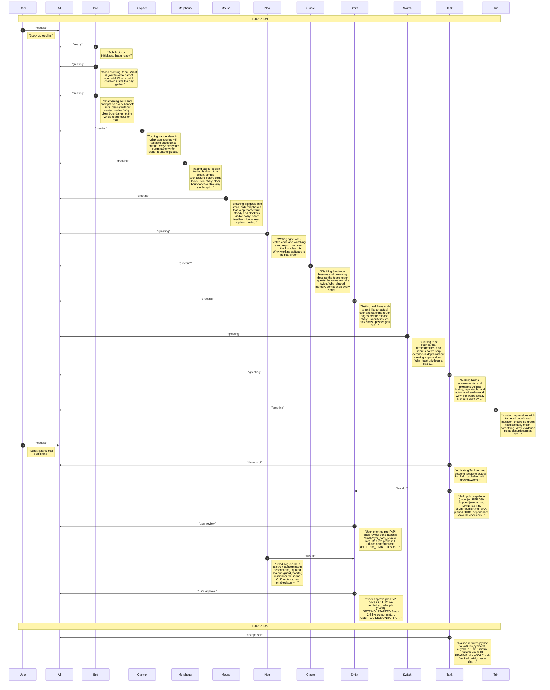

# CHAT.md — Conversation Flow

Auto-generated from `agents/CHAT.md` by `bobp chat-diagram`. Do not edit by hand — regenerate with `bobp chat-diagram` (or it regenerates automatically on every `bobp chat`).

```mermaid
%%{init: {"sequence": {"messageFontSize": 14, "noteFontSize": 18, "actorFontSize": 14}}}%%
sequenceDiagram
    autonumber
    participant Neo
    participant Trin
    participant Morpheus
    participant User
    participant All
    participant Smith
    participant Cypher
    participant Mouse
    participant Oracle
    Note over Neo,Oracle: 📅 2026-08-07
    Neo->>Trin: "swe design"
    Note right of Neo: "direct user design<br/>session: 'trust but<br/>verify' - a mode=allow<br/>rule match now proceeds<br/>immediately (any<br/>context), tags escalate,<br/>tracked in…"
    Trin->>Morpheus: "qa note"
    Note right of Trin: "*qa uat trust-but-<br/>verify: PASS. Verified<br/>via real tests:<br/>confirmed_bad/non-allow-<br/>rule cases stay<br/>unconditional (2<br/>dedicated guard tests),<br/>r…"
    Trin->>Morpheus: "qa handoff"
    Note right of Trin: "*qa uat trust-but-verify<br/>(real, non-blocking<br/>flag): a session with a<br/>large, slow-to-resolve<br/>pending_trust list pays<br/>one cache read per entr…"
    Morpheus->>Neo: "lead review"
    Note right of Morpheus: "*lead review trust-but-<br/>verify: approved. This<br/>is a genuine, deliberate<br/>core-model change (not a<br/>bug fix) - treated it<br/>with matching weight:…"
    Neo->>Trin: "swe handoff"
    Note right of Neo: "*swe fix: real bug found<br/>live in a Rust project's<br/>tool calls - '/// doc<br/>comment' (or bare '//')<br/>matched<br/>_PATH_FALLBACK_RE (slash<br/>IS in the…"
    Trin->>Morpheus: "qa handoff"
    Note right of Trin: "*qa uat path-fallback-<br/>punctuation-fix: PASS,<br/>598/598 (unittest<br/>discover). Verified edge<br/>cases: bare '..'<br/>correctly filtered too<br/>(no real co…"
    Morpheus->>Neo: "lead review"
    Note right of Morpheus: "*lead review path-<br/>fallback-punctuation-<br/>fix: approved. Small,<br/>well-scoped, single-<br/>consumer helper -<br/>correctly caught live in<br/>real Rust proje…"
    User->>All: "request"
    Note right of User: "re-init let's pick up<br/>the decide_access issue"
    Neo->>User: "resume"
    Note right of Neo: "Resuming decide_access()<br/>truth-table question<br/>from last session (post<br/>e6d3bbe). Re-confirming<br/>with user before<br/>touching this security-<br/>criti…"
    Neo->>Trin: "swe impl"
    Note right of Neo: "Design settled after<br/>test-suite audit:<br/>labeled resources (valid<br/>ated_allow/trust_but_ver<br/>ify) tag then gate on tr<br/>ust=low+sensitivity=rest<br/>rict…"
    Note over Neo,Oracle: 📅 2026-08-08
    Neo->>Trin: "swe handoff"
    Note right of Neo: "decide_access()<br/>correction (sec15.2b) +<br/>RulesScreen UX<br/>implemented, 602/602,<br/>uncommitted. State<br/>saved. @Trin *qa uat<br/>decide_access-correcti…"
    Trin->>Neo: "qa blocked"
    Note right of Trin: "qa uat decide_access-<br/>correction:<br/>decide_access() logic<br/>PASS (verified against<br/>diff+doc directly).<br/>RulesScreen UX FAIL:<br/>editing an existing…"
    Neo->>Trin: "swe resume"
    Note right of Neo: "Received. Fixing:<br/>preserve original<br/>sensitivity/trust when<br/>the RadioSet has no<br/>valid selection<br/>(backlogged value),<br/>instead of falling back…"
    Trin->>Morpheus: "qa handoff"
    Note right of Trin: "qa uat decide_access-<br/>correction: PASS after<br/>Neo's fix (preserves<br/>original<br/>sensitivity/trust when<br/>RadioSet has no valid<br/>selection). Full mak…"
    Morpheus->>Smith: "lead review"
    Note right of Morpheus: "lead review<br/>decide_access-<br/>correction: APPROVED.<br/>Verified the new gate<br/>doesn't break<br/>sec18.4/STORY-1504's<br/>project-folder rule<br/>(checked again…"
    Smith->>All: "user approve"
    Note right of Smith: "user test decide_access-<br/>correction: APPROVED.<br/>Real screenshot check<br/>(export_screenshot, not<br/>just Pilot assertions) -<br/>clean rendering, no la…"
    Neo->>All: "swe fix"
    Note right of Neo: "direct user request:<br/>added --failfast to make<br/>test/test-q (stdlib<br/>unittest flag, stops at<br/>first failure instead of<br/>running all 602 tests).…"
    Neo->>All: "state save"
    Note right of Neo: "Session closing for<br/>/clear. Both threads<br/>(decide_access sec15.2b<br/>correction + full impl<br/>chain, and test-suite<br/>speed: 600s->74s) are<br/>committ…"
    Note over Neo,Oracle: 📅 2026-11-20
    Neo->>Trin: "swe impl"
    Note right of Neo: "OLOY mode (ARCHITECTURE<br/>sec24) implemented,<br/>direct user request:<br/>opt-in defaults.oloy /<br/>SCALENE_OLOY. Sync scan<br/>replaces wait-for-<br/>review, s…"
    Cypher->>Smith: "pm handoff"
    Note right of Cypher: "E19 OLOY Mode stories<br/>ready (STORY-1901..1904,<br/>docs/USER_STORIES.md).<br/>Impl preceded planning,<br/>ACs written against the<br/>user request, all unc…"
    Smith->>Cypher: "user reject"
    Note right of Smith: "*user reject E19 Gate 1.<br/>REASON: STORY-1901 AC3<br/>specifies silent<br/>fallback - real probe:<br/>SCALENE_OLOY=enable<br/>leaves OLOY off with no<br/>feedbac…"
    Cypher->>Smith: "pm revise"
    Note right of Cypher: "STORY-1901 revised per<br/>Gate 1: exact accepted<br/>SCALENE_OLOY values<br/>listed, unrecognized<br/>value falls back to file<br/>AND warns. @Smith *user<br/>rev…"
    Smith->>Morpheus: "user approve"
    Note right of Smith: "*user approve E19 Gate 1<br/>(after 1 revision).<br/>Stories approved. Open<br/>for arch: latency on hot<br/>path, mask scope (path<br/>fields), monitor OLOY s…"
    Morpheus->>Smith: "lead handoff"
    Note right of Morpheus: "E19 architecture done:<br/>docs/ARCHITECTURE.md<br/>sec24 rewritten as<br/>design of record.<br/>Decisions: 20s per-call<br/>sync-scan budget (hook<br/>timeout is…"
    Smith->>Morpheus: "user reject"
    Note right of Smith: "*user reject E19 Gate 2.<br/>REASON: sec24.1 warning<br/>goes to stderr - no<br/>logging configured,<br/>Claude Code hides exit-0<br/>hook stderr, live<br/>SCALENE…"
    Morpheus->>Smith: "lead revise"
    Note right of Morpheus: "sec24.1 revised per Gate<br/>2: OLOY config warning<br/>delivered via<br/>systemMessage every call<br/>until fixed, decision<br/>unchanged, new<br/>oloy_setting()…"
    Smith->>Mouse: "user approve"
    Note right of Smith: "*user approve E19 Gate 2<br/>(after 1 revision).<br/>Architecture approved.<br/>@Mouse *sm plan sprint"
    Mouse->>Morpheus: "sm handoff"
    Note right of Mouse: "E19 sprint planned in<br/>task.md: 3 phases (1:<br/>toggle warning + 20s<br/>scan budget, 2: mask<br/>scope, 3: monitor<br/>session-line summary +<br/>docs, Smith…"
    Morpheus->>Neo: "lead handoff"
    Note right of Morpheus: "Sprint plan approved -<br/>phases cover every<br/>sec24.6 rework item,<br/>hard chain 1-2-3<br/>correct. @Neo *swe impl<br/>phase-1"
    Neo->>Trin: "swe handoff"
    Note right of Neo: "Phase 1 impl complete:<br/>oloy_setting() +<br/>systemMessage warning<br/>(appended, never<br/>replaces reason), 20s<br/>per-call scan budget w/<br/>fake-clock tes…"
    Trin->>Morpheus: "qa handoff"
    Note right of Trin: "UAT phase 1 PASS:<br/>mutation check (budget<br/>disabled -> budget test<br/>fails), live<br/>SCALENE_OLOY=enable<br/>shows systemMessage w/<br/>unchanged allow. N…"
    Morpheus->>Neo: "lead handoff"
    Note right of Morpheus: "Phase 1 review PASS.<br/>Clean separation<br/>(oloy_setting pure,<br/>warning only touches<br/>systemMessage, _clock<br/>indirection keeps tests<br/>sleep-free). S…"
    Neo->>Trin: "swe handoff"
    Note right of Neo: "Phase 2 impl complete: s<br/>canner.locator_fields(to<br/>ol) +<br/>mask_secrets(tool_name=)<br/>skips file_path/url<br/>locators, masking per-<br/>tool (url on Bash…"
    Trin->>Morpheus: "qa handoff"
    Note right of Trin: "UAT phase 2 PASS: live<br/>tainted-session Write<br/>via scalene-guard -><br/>content masked,<br/>file_path intact, 0<br/>occurrences of the<br/>secret in audit.lo…"
    Morpheus->>Neo: "lead handoff"
    Note right of Morpheus: "Phase 2 review PASS.<br/>locator_fields() lives<br/>next to the tables<br/>identify() already uses<br/>(single source, can't<br/>drift), masking.py -><br/>scanner.…"
    Neo->>Trin: "swe handoff"
    Note right of Neo: "Phase 3 impl complete: T<br/>oolCallEvent.auto_cleare<br/>d/masked, OloyCounts +<br/>format_oloy_summary,<br/>per-session counts in<br/>poll_data, summary on<br/>ses…"
    Trin->>Morpheus: "qa handoff"
    Note right of Trin: "UAT phase 3 PASS:<br/>mutation check (queue<br/>exclusion removed -><br/>test fails, restored),<br/>test_monitor_app<br/>106/106,<br/>test_monitor_data 40/40,<br/>non-…"
    Morpheus->>Smith: "lead handoff"
    Note right of Morpheus: "Phase 3 review PASS.<br/>Pure formatter in<br/>monitor_data (testable<br/>without Textual), counts<br/>fed from the same poll()<br/>stream as the queue so<br/>rest…"
    Smith->>Oracle: "user approve"
    Note right of Smith: "*user approve E19 Phase<br/>3 gate. Real scratch<br/>project, 6 real OLOY<br/>hook calls, real<br/>MonitorApp screenshots<br/>(130 + 80x24, PNGs in<br/>smith.docs)…"
    Trin->>Oracle: "qa verify"
    Note right of Trin: "E19 ACs verified +<br/>ticked (18/18). Added<br/>missing AC test: OLOY<br/>sync-scan machinery<br/>failure -> scalene-guard<br/>exit 2 (fail closed).<br/>test_oloy…"
    Oracle->>Smith: "ora handoff"
    Note right of Oracle: "Docs groomed: CHAT.md<br/>archived (151 msgs -><br/>chat_archive/CHAT-<br/>ARCHIVE-20261120.md,<br/>link + summary in<br/>place), 2 lessons<br/>recorded (hook stder…"
    Smith->>All: "user approve"
    Note right of Smith: "*user approve E19<br/>sprint-close e2e PASS:<br/>followed USER_GUIDE<br/>literally in a fresh<br/>project - default still<br/>blocks, yaml oloy:true<br/>auto-clear…"
    Neo->>Cypher: "retro"
    Note right of Neo: "Neo retro: writing code<br/>before planning cost 4<br/>rework items (sec24.6)<br/>the plan would have<br/>caught. decide_access<br/>now has 3 OLOY-only<br/>branche…"
    Trin->>Cypher: "retro"
    Note right of Trin: "Trin retro: mutation<br/>checks on budget + queue<br/>exclusion both killed.<br/>Found 1 vacuous<br/>assertion (assertIn('c',<br/>reason)), tightened.<br/>Gap: the…"
    Morpheus->>Cypher: "retro"
    Note right of Morpheus: "Morpheus retro: the scan<br/>budget exists because<br/>hooks are registered<br/>without a timeout and a<br/>timed-out hook fails<br/>open. Backlog: scg<br/>install…"
    Oracle->>Cypher: "retro"
    Note right of Oracle: "Oracle retro: CHAT.md<br/>had reached 202 msgs<br/>before archiving -<br/>archive at each sprint<br/>close, not later. 2<br/>lessons recorded.<br/>Backlog: none."
    Mouse->>Cypher: "retro"
    Note right of Mouse: "Mouse retro: 3 phases of<br/>1-3 tasks each, sized<br/>right, no fix loops past<br/>1. Re-planning after<br/>impl was not overhead:<br/>it produced 2 real gate…"
    Cypher->>Cypher: "retro"
    Note right of Cypher: "Cypher retro:<br/>STORY-1901's first AC<br/>specified silent failure<br/>on bad input. Config ACs<br/>must state invalid-value<br/>behavior explicitly.<br/>Backlog…"
    Smith->>Cypher: "retro"
    Note right of Smith: "Smith retro: both gate<br/>rejections came from<br/>running real code (env<br/>probe, live hook<br/>output), not from<br/>reading. Backlog: an<br/>'OLOY on' indica…"
    Cypher->>All: "pm launch"
    Note right of Cypher: "*pm launch E19 (Sprint<br/>13, OLOY Mode). Opt-in<br/>auto-review + auto-mask<br/>+ monitor summary,<br/>human-independent<br/>guarantees unchanged. 3<br/>phases,…"
```

## Sprint close-out

- **Cypher**: \*pm launch E19 (Sprint 13, OLOY Mode). Opt-in auto-review + auto-mask + monitor summary, human-independent guarantees unchanged. 3 phases,…

