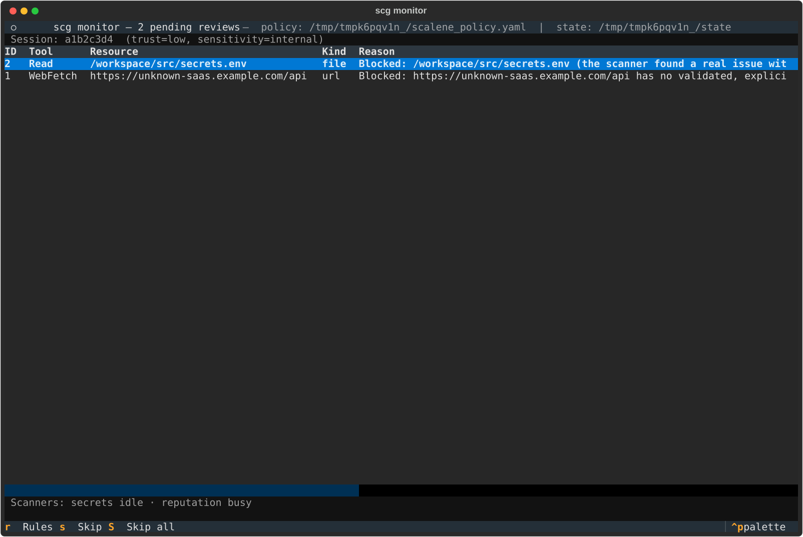

# `scg monitor` — Interactive TUI Guide

A full walkthrough of `scg monitor`, the live terminal dashboard over your
project's Scalene activity. New to Scalene entirely? Start with
[GETTING_STARTED.md](GETTING_STARTED.md) first. For the rest of the CLI,
see [USER_GUIDE.md](USER_GUIDE.md).

All screenshots on this page are real — generated by actually running
`MonitorApp` headless against seeded data
(`docs/generate_monitor_screenshots.py`, or `make screenshots`), not
mockups. Re-run after any change to the TUI's appearance to keep this
guide honest.

```
pip install scalene-guard[monitor]   # already included by `make setup` in this repo
scg monitor
```

Takes no flags. Run it in its own terminal, alongside the agent session you
want to watch.

---

## The main view: your approval queue



The home screen revolves around one thing: what needs your attention right
now. There's no session picker — the session line always tracks whichever
agent session touched Scalene most recently, live, so it stays relevant to
whatever you're actually doing.

- **Session line** (top) — the current session's id, trust, and
  sensitivity tags, re-pointing automatically if a newer session starts.
- **Queue** — one row per blocked tool call still awaiting your decision,
  oldest first: which tool, how many resources it touched, what kind
  (file/url), the block reason, and how long it's been waiting. `↑`/`↓` to
  move, `Enter` to open a review — any row, not just the oldest.
- **Status strip** (bottom, above the keybinding row) — one line, one
  clause per configured scanner: `secrets idle · reputation busy`. The
  same real idle/busy signal the hook's own scan cache reservations
  produce, not a simulated indicator.

When a call gets blocked, the window title picks up a live count (e.g.
*"scg monitor — 2 pending reviews"*) and the terminal bell rings — you
don't have to be staring at the screen to notice.

Press **`r`** any time to open the [Rules screen](#reordering-your-rules).

---

## Reviewing a blocked call

Select any row in the queue and press **Enter**:


You see exactly what the hook saw: the tool name, the real call arguments
as JSON, and every identified target with its current onboarded/validated
status. A target that's never been scanned reads `not yet scanned`; once
scanned, it reads `<label> (fresh)` or `<label> (expired)` depending on
Scalene's own 24h freshness window.

**The Tool/Pattern/Sensitivity/Mode fields sit at the top, always visible
and editable** — not hidden behind an extra click. As you edit the
Pattern, the targets table's **Matches?** column updates live, so you can
see exactly which targets a widened rule would cover *before* you commit
to it — no more guessing and finding out after the fact. An in-progress
edit that isn't valid yet (e.g. a half-typed regex) shows `—`, not a false
`no`.

Three actions, always visible:

- **Verify** — runs a real scan against every listed target. This doesn't
  decide anything by itself; it populates the scan cache so you (and
  Allow) have real, current data to act on. While a scan is in flight
  you'll see it reflected in the status strip's busy state too — Verify
  reuses the exact same activity signal.
- **Deny** — closes the review. Nothing is written; the original call
  stays blocked, same as it already was.
- **Allow** — **stays disabled until every target has been Verified**,
  and re-checks that itself at the moment you submit (not just at the
  button) — so pressing Enter in the Pattern field before Verifying
  refuses with a clear message instead of silently writing an unreviewed
  rule.


Pressing **Escape** instead of choosing an action just closes the review
for now — it stays queued, ready to reopen from the queue screen. Nothing
about the original call changes either way; it was already resolved
(denied) the moment it happened. This screen is a to-do list, not a live
gate.

The `pattern` Scalene will write defaults to the real, exact resource that
was blocked — the same tight, narrow default `scg onboard` uses, not a
wildcard. You only choose:

- **Sensitivity** — `public` / `internal` / `restricted` (defaults `public`).
- **Mode** — `allow` / `block` (defaults `allow`). Use `block` to
  explicitly declare a *confirmed-bad* finding blocked-on-purpose, backed
  by a real scan result — the one case where this form is still the right
  place to author a deliberate block.

Clicking **Allow** writes the rule directly to your real
`scalene_policy.yaml` — the same file `scg onboard` writes to, no separate
mechanism. The review dequeues, and the identical original tool call —
retried by the agent — is now genuinely allowed.

If a target's last scan came back with a real finding (`sensitive` /
`untrusted`) and you leave Mode at `allow`, Allow is rejected with a clear
reason instead of silently writing a rule that contradicts the scan — the
same guard `scg onboard` has always applied, reused here rather than
duplicated.

---

## Reordering your rules

Press **`r`** from the queue screen to see every rule in your real
`scalene_policy.yaml`, in the order that actually matters:


Rule order **is** precedence — the first rule that matches a resource
wins, not the most specific one. This screen shows that real order
directly, with `k`/`j` to move the selected rule up or down. Each move
rewrites the real policy file immediately and shows a confirmation
(`Moved rule #2 → #1 — saved.`) before your next keypress does anything
else — reordering has real, immediate access-control consequences (a
broad rule moved ahead of a specific one can make the specific one
permanently unreachable), so the write is never silent.

Press **Escape** to return to the queue.

---

## What the agent sees, meanwhile

None of this is visible to the agent whose call got blocked — `scg
monitor` is entirely operator-side. What the agent *does* see, in its own
tool-call response, is the `reason` text explaining the block, worded to
tell it what to do next:

- Blocked with nothing confirmed wrong yet → *"...has no validated,
  explicitly-allowed rule... **Wait for review, then retry.**"*
- Blocked on a real finding → *"...**Do not retry without a rule/config
  change.**"*

So the loop is: agent gets blocked and told to wait → you see it land in
the queue → you open it, Verify, and Allow (or Deny) → the agent retries
and either succeeds or gets the same guidance again.

---

## Regenerating the screenshots on this page

```
make screenshots
```

Boots the real `MonitorApp` headless (Textual's own test harness) against
seeded queue/cache/policy data and exports real SVG screenshots to
`docs/images/`. No mocking, no hand-editing the output — if the TUI's
appearance changes, re-run this and the diff shows exactly what changed.
